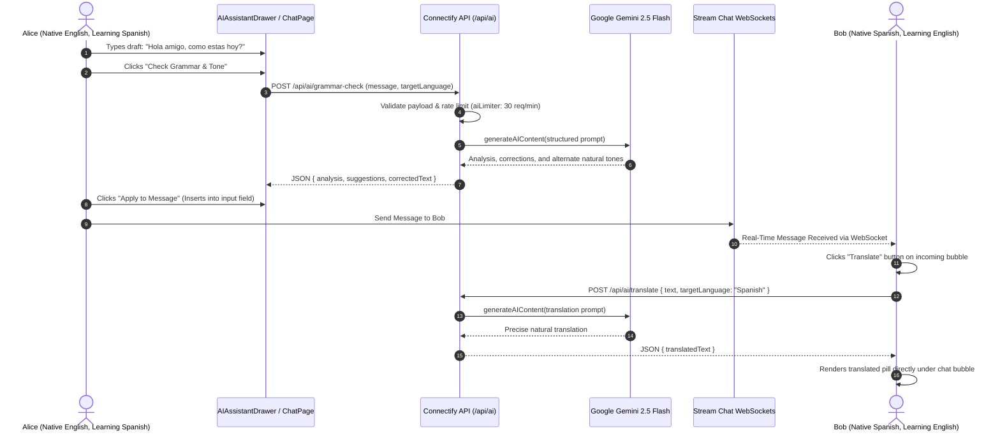
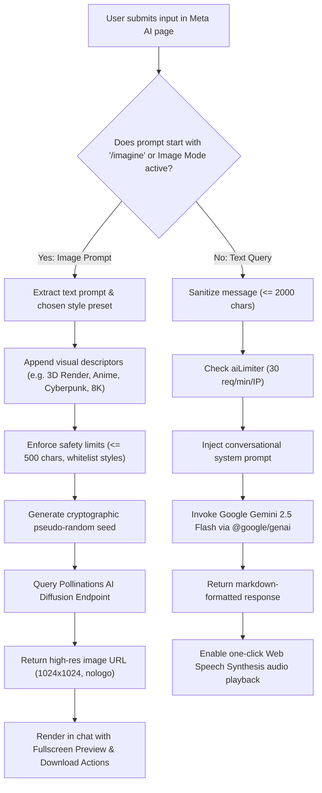
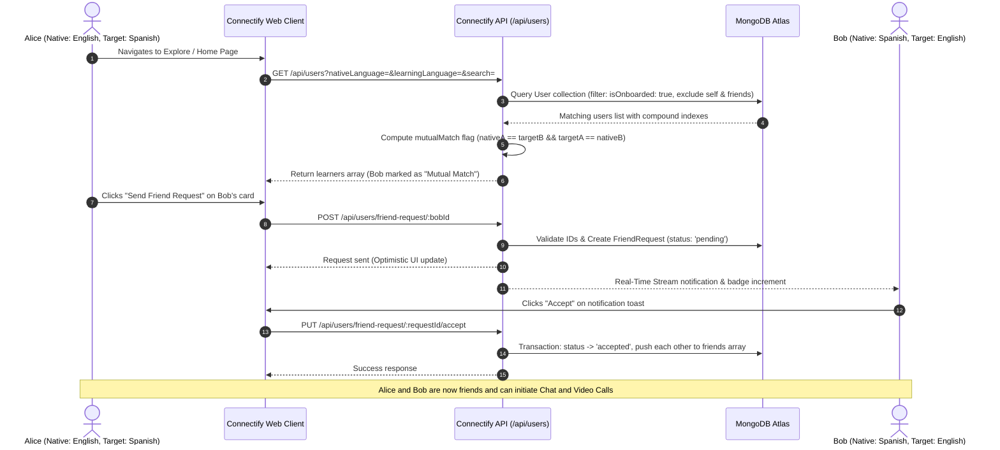

# Connectify

Real-Time Language Exchange, 1-on-1 Chat, HD Video Calls, and Gemini AI Language Assistance.

<p align="center">
  
  
  
  
  
  <a href="https://connectify-videocall.vercel.app" target="_blank"></a>
  <a href="https://github.com/Satyam6201/Connectify" target="_blank"></a>
</p>

---

## Table of Contents
1. [Overview](#overview)
2. [High-Level System Architecture](#high-level-system-architecture)
3. [Core System Design and Sequence Workflows](#core-system-design-and-sequence-workflows)
   - [Real-Time Video Calling & WebRTC SFU Flow](#1-real-time-video-calling--webrtc-sfu-flow)
   - [Real-Time Chat & In-Message AI Language Assistance](#2-real-time-chat--in-message-ai-language-assistance)
   - [Meta AI Assistant & `/imagine` Image Generation Pipeline](#3-meta-ai-assistant--imagine-image-generation-pipeline)
   - [Friend Discovery & Mutual Language Matching Flow](#4-friend-discovery--mutual-language-matching-flow)
4. [System Design Deep Dive](#system-design-deep-dive)
   - [WebRTC SFU Architecture vs P2P Mesh](#webrtc-sfu-architecture-vs-p2p-mesh)
   - [Distributed Sliding-Window Rate Limiting](#distributed-sliding-window-rate-limiting)
   - [Database Indexing & Query Optimization](#database-indexing--query-optimization)
   - [Security & Defense-in-Depth Model](#security--defense-in-depth-model)
   - [Frontend State & Bundle Optimization](#frontend-state--bundle-optimization)
5. [Key Features](#key-features)
6. [Tech Stack](#tech-stack)
7. [API Endpoints Reference](#api-endpoints-reference)
8. [Project Structure](#project-structure)
9. [Environment Variables Configuration](#environment-variables-configuration)
10. [Installation & Setup](#installation-and-setup)
11. [Production Deployment](#production-deployment)
12. [License](#license)

---

## Overview

**Connectify** is a production-grade, distributed web platform designed for global language exchange and real-time collaboration. Users discover native speakers for language exchange based on mutual learning algorithms, communicate via persistent 1-on-1 WebSocket chat, launch low-latency HD video calls via WebRTC, and leverage Gemini AI for live message translations, tone coaching, and image generation.

The architecture emphasizes sub-100ms real-time interactions, resilient rate limiting, defense-in-depth security, compound database indexing, and modular code splitting.

---

## High-Level System Architecture

The following diagram illustrates the multi-tier architectural layout of Connectify, detailing the interaction between the client presentation layer, gateway and security middleware, Node.js application services, distributed databases, and external cloud infrastructure.

```mermaid
flowchart TD
    subgraph ClientTier ["Client Presentation Tier (Browser / Mobile)"]
        SPA["React 19 Single Page Application"]
        UI["Tailwind CSS + DaisyUI (32 Themes)"]
        QueryState["TanStack React Query v5 & Zustand"]
        StreamChatUI["Stream Chat React SDK"]
        StreamVideoUI["Stream Video React SDK"]
        SPA --- UI
        SPA --- QueryState
        SPA --- StreamChatUI
        SPA --- StreamVideoUI
    end

    subgraph EdgeLayer ["Edge, Reverse Proxy & Security"]
        Nginx["Nginx Reverse Proxy / Static Host"]
        CORS["Strict CORS & Security Headers"]
        RateLimiter["Sliding-Window Rate Limiter"]
        Compression["Gzip / Deflate Compression"]
        Nginx --> CORS --> RateLimiter --> Compression
    end

    subgraph ApplicationTier ["Application Server Tier (Node.js & Express)"]
        AuthService["Auth Controller & JWT Verification"]
        UserEngine["User & Language Matching Engine"]
        StreamTokenService["Stream Credentials & Token Minting"]
        AIEngine["AI Controller (Gemini & Image Engine)"]
    end

    subgraph PersistenceTier ["Data & Caching Tier"]
        MongoDB[("MongoDB Atlas Database")]
        UserColl["Users Collection (Compound Indexed)"]
        ReqColl["FriendRequests Collection"]
        RedisServer[("Redis 7 In-Memory Cache")]
        RateStore["Sliding Window Store (ZSET / TTL)"]
        MongoDB --- UserColl
        MongoDB --- ReqColl
        RedisServer --- RateStore
    end

    subgraph ExternalServices ["External Real-Time & Cloud Infrastructure"]
        StreamChatEdge["Stream Chat Network (WebSockets)"]
        StreamVideoSFU["Stream WebRTC Edge (SFU Mesh)"]
        GeminiAPI["Google Gemini AI (Language Engine)"]
        PollinationsAPI["Pollinations.ai (Diffusion Engine)"]
    end

    %% Communication Paths
    ClientTier -->|HTTPS / REST API Requests| Nginx
    Compression --> AuthService
    Compression --> UserEngine
    Compression --> StreamTokenService
    Compression --> AIEngine

    AuthService --> MongoDB
    UserEngine --> MongoDB
    RateLimiter <--> RedisServer

    StreamTokenService -->|Server-Side Minting| StreamChatEdge
    StreamTokenService -->|Server-Side Minting| StreamVideoSFU

    AIEngine -->|Generative Prompts| GeminiAPI
    AIEngine -->|Diffusion Rendering| PollinationsAPI

    StreamChatUI <==>|Direct WebSocket Mesh (Chat/Presence)| StreamChatEdge
    StreamVideoUI <==>|Direct WebRTC Audio/Video Streams| StreamVideoSFU
```

---

## Core System Design and Sequence Workflows

### 1. Real-Time Video Calling & WebRTC SFU Flow

Connectify implements low-latency 1-on-1 HD video calling using the Stream Video SDK backed by a Selective Forwarding Unit (SFU) network. The backend securely mints short-lived user tokens via HMAC-SHA256, allowing the frontend client to negotiate peer connections directly with the nearest media edge server.

```mermaid
sequenceDiagram
    autonumber
    actor Alice as User Alice (Caller)
    participant ClientA as Alice's Browser
    participant Backend as Connectify API
    participant StreamSFU as Stream WebRTC SFU
    participant ClientB as Bob's Browser
    actor Bob as User Bob (Callee)

    Alice->>ClientA: Clicks "Launch Video Call"
    ClientA->>Backend: GET /api/chat/token (JWT Auth Cookie)
    Backend-->>ClientA: Returns Signed Stream Token
    ClientA->>StreamSFU: Initialize Call Object & Create Room (callId)
    StreamSFU-->>ClientA: Room Ready & WebRTC Signaling Established
    ClientA->>Alice: Display Local Camera Preview & In-Call Controls

    Note over ClientA,ClientB: Alice shares Call URL with Bob via Stream Chat
    Bob->>ClientB: Opens Call Link (/call/:callId)
    ClientB->>Backend: GET /api/chat/token
    Backend-->>ClientB: Returns Signed Stream Token
    ClientB->>StreamSFU: Join Call (callId) with Local Media Stream

    Note over ClientA,StreamSFU,ClientB: WebRTC Negotiation: SDP Offer/Answer + ICE Candidates
    StreamSFU-->>ClientA: Forward Bob's Encrypted Media Tracks
    StreamSFU-->>ClientB: Forward Alice's Encrypted Media Tracks
    Note over ClientA,ClientB: HD Video & Audio streaming peer-to-SFU

    Alice->>ClientA: Clicks "Leave Call"
    ClientA->>StreamSFU: activeCall.leave() & activeClient.disconnectUser()
    ClientA->>Alice: Release camera/mic tracks & Redirect to Home
```

---

### 2. Real-Time Chat & In-Message AI Language Assistance

The chat architecture couples persistent WebSocket communication with on-demand AI language assistance (Grammar Correction, Tone Coaching, and Instant Message Translation) powered by Gemini AI.



---

### 3. Meta AI Assistant & `/imagine` Image Generation Pipeline

Connectify features a Meta AI conversational assistant (similar to Meta AI in WhatsApp). When a user inputs a query or triggers `/imagine <prompt>`, the backend categorizes the intent and either streams an LLM response or triggers an image diffusion render.



---

### 4. Friend Discovery & Mutual Language Matching Flow

The platform pairs users based on complementary language goals: a user who speaks English and is learning Spanish is matched with native Spanish speakers who are learning English.



---

## System Design Deep Dive

### WebRTC SFU Architecture vs P2P Mesh

In traditional Peer-to-Peer (P2P) WebRTC mesh topologies, each participant must encode and upload separate media streams to every other peer in the room.
* For $N$ participants, P2P requires $N \times (N - 1)$ video tracks across client uplinks, causing severe CPU and bandwidth bottlenecks on mobile devices even with small groups.
* **Connectify's SFU Implementation**: Connectify uses the Stream Video Selective Forwarding Unit (SFU) network. Each client encodes and uploads **exactly one** upstream video track to the edge server. The SFU intelligently duplicates and forwards downlinks to peers. This preserves mobile battery life, enforces dynamic bitrate scaling (simulcast), and minimizes end-to-end latency to under 100ms.

### Distributed Sliding-Window Rate Limiting

To protect authentication, user discovery, and expensive generative AI endpoints from Denial of Service (DoS) attacks and brute-force attempts:
* The backend employs a **Redis sliding-window rate limiter** implemented using atomic sorted sets (`ZSET`).
* Incoming request timestamps are recorded with millisecond precision (`ZADD`). Outdated entries outside the current window are pruned with `ZREMRANGEBYSCORE`.
* The remaining set cardinality (`ZCARD`) is compared against the route threshold (e.g., 30 req/min for AI endpoints, 60 req/min for general API routes).
* **Fault-Tolerant Memory Fallback**: If Redis is temporarily unreachable or running in a container-less local environment, the middleware gracefully falls back to an in-memory TTL map with automated periodic garbage collection every 5 minutes to prevent Node.js heap leaks.

### Database Indexing & Query Optimization

To maintain sub-10ms database response times at scale, MongoDB compound indexes are implemented to back all primary queries:

```javascript
// User Collection Indexes
userSchema.index({ isOnboarded: 1 });
userSchema.index({ nativeLanguage: 1, learningLanguage: 1 }); // Accelerates mutual partner discovery
userSchema.index({ fullName: "text" });                       // Enables text search with escapeRegex

// FriendRequest Collection Indexes
friendRequestSchema.index({ recipient: 1, status: 1 });       // Fast lookup for incoming notifications
friendRequestSchema.index({ sender: 1, status: 1 });          // Fast lookup for pending outgoing requests
friendRequestSchema.index({ sender: 1, recipient: 1 });       // Fast duplicate request prevention
```

### Security & Defense-in-Depth Model

1. **Mass Assignment Prevention**: Critical update endpoints (`onboard`, `updateProfile`) strictly allowlist editable attributes (`fullName`, `bio`, `nativeLanguage`, `learningLanguage`, `location`, `profilePic`), preventing injection of administrative fields.
2. **Password & Data Sanitization**: Hashed passwords are explicitly stripped from all `signup` and `login` JSON responses. Passwords must pass length validation (6–128 characters) and are salted with Bcrypt (10 rounds).
3. **ReDoS Defense**: All user search queries are escaped using `escapeRegex` before regex compilation, mitigating catastrophic backtracking Denial of Service.
4. **CastError / ObjectId Guards**: All route parameters are validated using `mongoose.Types.ObjectId.isValid()`, preventing server 500 crashes from malformed hexadecimal parameters.
5. **Session Cookies & Transport Security**: JWT tokens are transmitted via `HttpOnly`, `SameSite: strict` cookies, preventing cross-site scripting (XSS) token exfiltration.
6. **HTTP Security Headers**: Express sets `X-Content-Type-Options: nosniff`, `X-Frame-Options: SAMEORIGIN`, `X-XSS-Protection: 1; mode=block`, and `Referrer-Policy: strict-origin-when-cross-origin`, while suppressing `X-Powered-By`.

### Frontend State & Bundle Optimization

* **TanStack React Query v5**: Handles asynchronous server state, automated refetching on window focus, optimistic UI updates on friend requests, and query caching.
* **Vite Vendor Chunk Splitting**: To avoid slow initial bundle downloads, `vite.config.js` splits third-party libraries into dedicated vendor chunks (`vendor-stream-chat`, `vendor-stream-video`, `vendor-query`, `vendor-react`), achieving fast First Contentful Paint (FCP).
* **Memory Leak Teardown**: Components mounting WebRTC or WebSocket listeners (`CallPage.jsx`, `ChatPage.jsx`) bind cleanup closures in `useEffect` unmount hooks (`activeCall.leave()`, `activeClient.disconnectUser()`), eliminating zombie microphone/camera usage.

---

## Key Features

### Meta AI Assistant & AI Image Generation
* **Ask Anything & Chat Assistant**: Conversational AI providing instant answers for language learning, coding, writing, and general knowledge.
* **Instant AI Image Generation**: Generate artwork by typing `/imagine <prompt>` or switching to Image Mode with 6 customizable style presets (Cinematic, Anime, Cyberpunk, 3D Render, Oil Painting, Photorealistic).
* **High-Res Modal Preview & Download**: Fullscreen lightbox preview with one-click direct download.
* **Real-Time Message Translation**: Instant in-chat translation for incoming bubbles into the user's native tongue.
* **AI Grammar & Tone Coach**: Contextual grammar corrections, explanations, and natural tone variants.
* **Speech Synthesis**: Native Text-to-Speech audio pronunciation for AI answers.

### Authentication & Account Management
* Secure session management via JWT in HTTP-Only cookies.
* Bcrypt password hashing with pre-save Mongoose hooks.
* Multi-field onboarding flow with avatar style customization.

### Language Exchange & Discovery
* Mutual language matching highlights ideal reciprocal learning partners.
* Multi-criteria filtering by language, name, and geographic location.
* Complete friendship lifecycle (send, accept, decline, cancel, and mutual unfriend).

### Real-Time Chat & Video Calling
* Direct 1-on-1 messaging powered by Stream Chat SDK.
* Low-latency 1-on-1 HD video calling powered by Stream Video SDK with microphone and camera toggles.
* Embedded AI Language Coach drawer inside the chat interface.

### UI & Theming
* 32 DaisyUI theme presets synchronized via Zustand to `localStorage`.
* Fully responsive layout optimized for mobile, tablet, and desktop screens.
* Toast notification alerts for real-time incoming requests.

---

## Tech Stack

| Layer | Technologies |
| :--- | :--- |
| **Frontend Framework** | React 19, Vite, Tailwind CSS, DaisyUI, Framer Motion, React Icons |
| **State & Cache Management** | TanStack React Query v5, Zustand, Axios |
| **Real-Time Communication** | Stream Chat React SDK, Stream Video React SDK (WebRTC SFU) |
| **AI Engines** | Google Generative AI (Gemini 2.5 Flash via `@google/genai`), Pollinations.ai Diffusion Engine |
| **Backend Runtime** | Node.js, Express.js (ES Modules), Gzip Compression, Cookie-Parser, CORS |
| **Databases & Cache** | MongoDB Atlas (Mongoose), Redis 7 (ioredis) |
| **Security & Rate Limiting** | JWT, Bcrypt.js, Redis Sliding Window Rate Limiter |
| **DevOps & Containers** | Docker, Docker Compose, Nginx Alpine |

---

## API Endpoints Reference

### Authentication Routes (`/api/auth`)
| Method | Endpoint | Description |
| :--- | :--- | :--- |
| `POST` | `/api/auth/signup` | Register a new user account |
| `POST` | `/api/auth/login` | Authenticate user and issue JWT cookie |
| `POST` | `/api/auth/logout` | Clear JWT session cookie |
| `POST` | `/api/auth/onboarding` | Complete initial user profile setup |
| `PUT` | `/api/auth/profile` | Update profile bio, location, languages, avatar |
| `GET` | `/api/auth/me` | Fetch currently authenticated user session |

### AI Assistance & Image Generation Routes (`/api/ai`)
| Method | Endpoint | Description |
| :--- | :--- | :--- |
| `POST` | `/api/ai/chat` | Chat with Meta AI assistant / Q&A / `/imagine` parsing |
| `POST` | `/api/ai/generate-image` | Generate AI image from prompt with style presets |
| `POST` | `/api/ai/translate` | Translate text into target language using Gemini AI |
| `POST` | `/api/ai/grammar-check` | Analyze sentence grammar, tone, and suggest alternatives |

### User & Friendship Routes (`/api/users`)
| Method | Endpoint | Description |
| :--- | :--- | :--- |
| `GET` | `/api/users` | Get recommended learners (supports `search`, `nativeLanguage`, `learningLanguage`) |
| `GET` | `/api/users/friends` | Get current user's friends list |
| `DELETE` | `/api/users/friends/:id` | Remove a friend (mutual bi-directional unfriend) |
| `POST` | `/api/users/friend-request/:id` | Send a friend request |
| `PUT` | `/api/users/friend-request/:id/accept` | Accept an incoming friend request |
| `DELETE` | `/api/users/friend-request/:id/reject` | Decline an incoming friend request |
| `DELETE` | `/api/users/friend-request/:id/cancel` | Cancel an outgoing pending friend request |
| `GET` | `/api/users/friend-requests` | Get pending incoming requests |
| `GET` | `/api/users/outgoing-friend-requests` | Get pending outgoing requests |

### Real-Time Credentials (`/api/chat`)
| Method | Endpoint | Description |
| :--- | :--- | :--- |
| `GET` | `/api/chat/token` | Mint signed Stream user token for Chat and Video SDKs |

---

## Project Structure

```
Connectify/
├── Backend/
│   ├── src/
│   │   ├── controllers/
│   │   │   ├── ai.controller.js      # Gemini & Pollinations AI logic
│   │   │   ├── auth.controller.js    # Auth, registration, onboarding
│   │   │   ├── chat.controller.js    # Stream token generation
│   │   │   └── user.controller.js    # Friendships, search, matching
│   │   ├── lib/
│   │   │   ├── db.js                 # MongoDB connection handler
│   │   │   ├── gemini.js             # Google Generative AI client
│   │   │   ├── redis.js              # Redis connection & fallback client
│   │   │   └── stream.js             # Stream Chat client instance
│   │   ├── middleware/
│   │   │   ├── auth.middleware.js    # JWT verification & token expiry
│   │   │   └── rateLimiter.js        # Redis sliding-window limiter
│   │   ├── models/
│   │   │   ├── FriendRequest.js      # FriendRequest Mongoose schema
│   │   │   └── User.js               # User schema with indexes & Bcrypt
│   │   ├── routes/
│   │   │   ├── ai.route.js           # AI endpoints
│   │   │   ├── auth.route.js         # Authentication endpoints
│   │   │   ├── chat.route.js         # Stream token routes
│   │   │   └── user.route.js         # User discovery & friend routes
│   │   └── server.js                 # Express server & security headers
│   ├── Dockerfile
│   └── package.json
│
├── Frontend/
│   ├── src/
│   │   ├── components/
│   │   │   ├── AIAssistantDrawer.jsx # Chat AI helper drawer
│   │   │   ├── CallButton.jsx        # Video call trigger
│   │   │   ├── ChatLoader.jsx        # Chat loading skeleton
│   │   │   ├── EditProfileModal.jsx  # Profile updater
│   │   │   ├── FriendCard.jsx        # Learner discovery card
│   │   │   ├── LanguageFlag.jsx      # Country flag badge
│   │   │   ├── Layout.jsx            # Global shell layout
│   │   │   ├── Navbar.jsx            # Top navigation bar
│   │   │   ├── Sidebar.jsx           # App navigation sidebar
│   │   │   └── ThemeSelector.jsx     # 32-theme selector
│   │   ├── hooks/
│   │   │   ├── useAuthUser.js        # Current session query
│   │   │   ├── useLogin.js           # Login mutation
│   │   │   ├── useLogout.js          # Logout mutation
│   │   │   ├── useRealtimeNotifications.js # Toast notifications
│   │   │   └── useSignup.js          # Signup mutation
│   │   ├── lib/
│   │   │   ├── api.js                # Centralized Axios API client
│   │   │   ├── axios.js              # Axios instance configuration
│   │   │   └── utils.js              # Formatting utilities
│   │   ├── pages/
│   │   │   ├── CallPage.jsx          # Stream WebRTC 1-on-1 video call
│   │   │   ├── ChatPage.jsx          # Stream 1-on-1 real-time chat
│   │   │   ├── FriendsPage.jsx       # Friends management
│   │   │   ├── HomePage.jsx          # Discovery & mutual matching
│   │   │   ├── LoginPage.jsx         # Login screen
│   │   │   ├── MetaAIPage.jsx        # Meta AI assistant & Image Gen
│   │   │   ├── NotificationsPage.jsx # Pending requests
│   │   │   ├── OnboardingPage.jsx    # Profile setup
│   │   │   └── SignUpPage.jsx        # Registration screen
│   │   ├── store/
│   │   │   └── useThemeStore.js      # Zustand theme persistence
│   │   ├── App.jsx                   # Application routing
│   │   └── main.jsx                  # Entry point
│   ├── Dockerfile
│   ├── nginx.conf
│   └── vite.config.js
│
├── docker-compose.yml
├── package.json
└── README.md
```

---

## Environment Variables Configuration

### Backend (`Backend/.env`)
```env
PORT=5001
NODE_ENV=development
MONGO_URI=your_mongodb_connection_string
JWT_SECRET_KEY=your_secure_jwt_secret_key
STREAM_API_KEY=your_stream_api_key
STREAM_API_SECRET=your_stream_api_secret
GEMINI_API_KEY=your_gemini_api_key
REDIS_URI=redis://localhost:6379
CLIENT_URL=http://localhost:5173
```

### Frontend (`Frontend/.env`)
```env
VITE_STREAM_API_KEY=your_stream_api_key
VITE_API_URL=http://localhost:5001
```

---

## Installation and Setup

### Method 1: Running with Docker Compose (Recommended)

```bash
# Build and run Redis, Backend API, and Frontend SPA
docker compose up --build
```

* Frontend: `http://localhost:5173`
* Backend API: `http://localhost:5001`
* Redis: `localhost:6379`

### Method 2: Running Locally

```bash
# 1. Install root, backend, and frontend dependencies
npm run install

# 2. Start Redis server (or rely on built-in in-memory fallback)
redis-server

# 3. Start development servers
# Terminal 1 - Backend:
cd Backend
npm run dev

# Terminal 2 - Frontend:
cd Frontend
npm run dev
```

---

## Production Deployment

### Backend Deployment (Render / Railway / VPS)
1. Set Root Directory to `Backend`.
2. Build Command: `npm install`.
3. Start Command: `npm start`.
4. Configure Environment Variables (`MONGO_URI`, `JWT_SECRET_KEY`, `STREAM_API_KEY`, `STREAM_API_SECRET`, `GEMINI_API_KEY`, `CLIENT_URL`, `REDIS_URI`).

### Frontend Deployment (Vercel / Netlify / Cloudflare Pages)
1. Set Root Directory to `Frontend`.
2. Framework Preset: `Vite`.
3. Build Command: `npm run build`.
4. Output Directory: `dist`.
5. Configure Environment Variables (`VITE_STREAM_API_KEY`, `VITE_API_URL`).

---

## License

This project is licensed under the ISC License.
